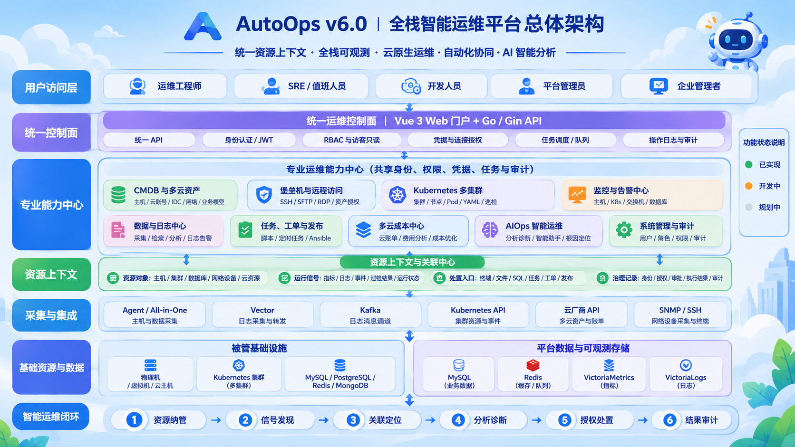
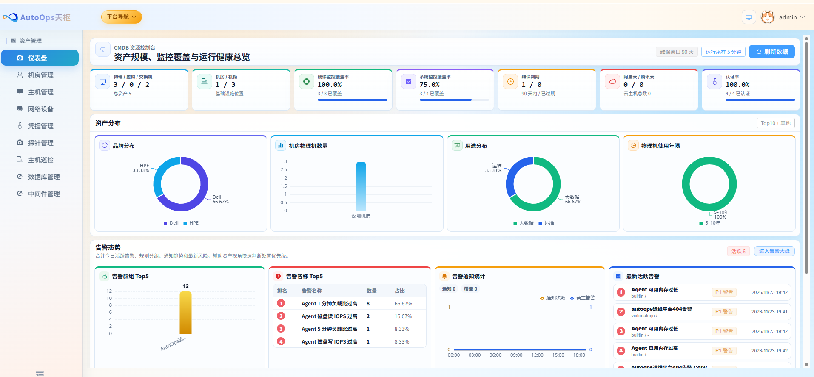
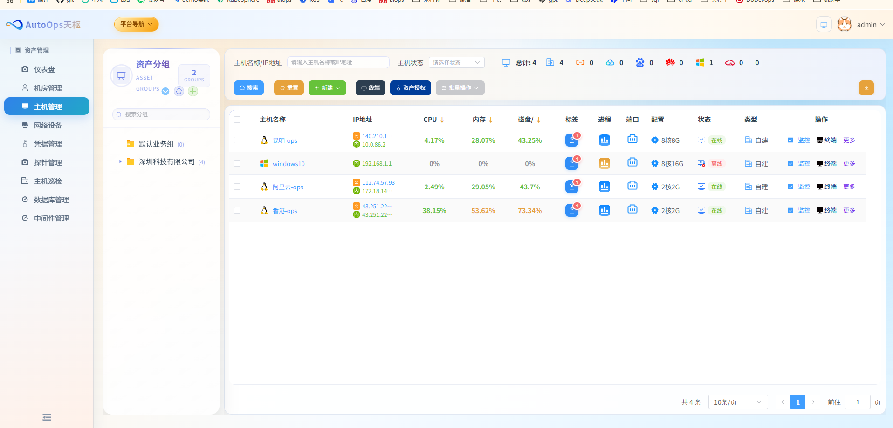
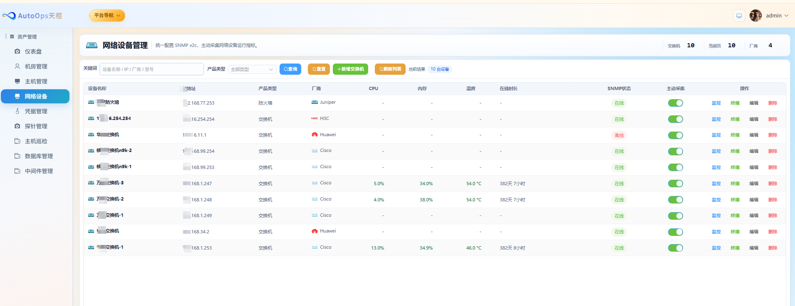
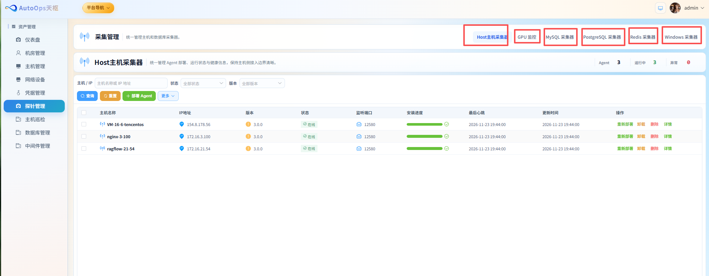
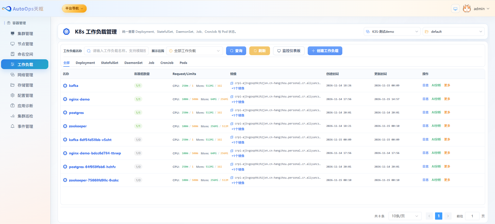
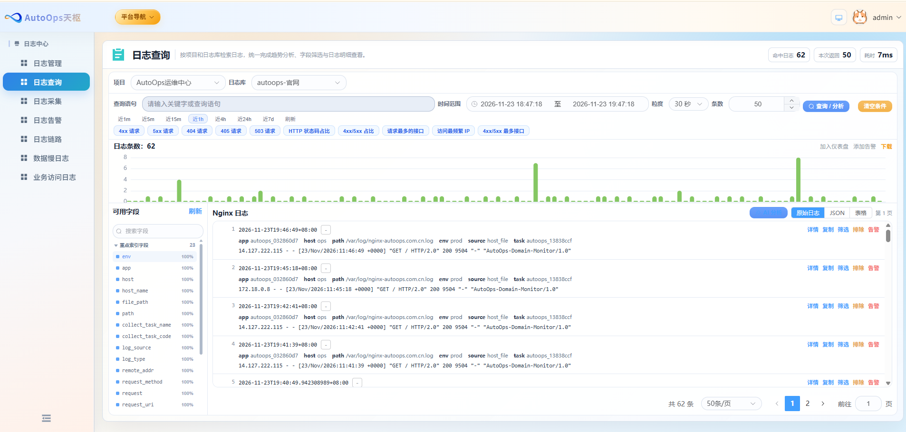

<h1 align="center">天枢 AutoOps v6</h1>
<p align="center"><strong>从资产定位、告警排查到工单处置的一站式运维平台</strong></p>
<p align="center">
  <a href="https://autoops.xin/dashboard">在线演示</a> ·
  <a href="#为什么选-autoops">选型对比</a> ·
  <a href="#v6-更新">v6 更新</a> ·
  <a href="#功能演示">功能演示</a> ·
  <a href="#快速部署">快速部署</a>
</p>

AutoOps 面向同时管理主机、多云资源和 Kubernetes 的运维团队。平台以 **CMDB 资产**为入口，把监控告警、日志、终端、SQL 审核、任务和发布工单放在同一个工作台。收到告警后，可以查找对应资产，查看指标、日志或巡检结果，再按权限进入终端、运行任务或提交变更工单。



## 为什么选 AutoOps

**优势**是从资产到处置都能在一个工作台完成，减少跨系统查找。**代价**是默认部署包含 8 个服务，需要为数据库、指标和日志等组件安排资源与维护。已有成熟的流水线、堡垒机或监控体系时，可以按需保留。

| 对比对象 | AutoOps v6 的优势 | 专项工具的优势与选用场景 |
| --- | --- | --- |
| [夜莺（Nightingale）][nightingale] | ✅ **内置告警中心**，规则、事件、静默和通知与资产、日志及巡检放在同一工作台 | **专注监控告警运营**。以多业务组规则管理、告警模板和通知路由为重点，或已有成套告警流程时，保留夜莺 |
| [Jenkins][jenkins] | 🔗 **对接 Jenkins**，将发布审批、触发构建和查看日志放进发布工单 | **构建与流水线执行**由 Jenkins 负责。已有 `Jenkinsfile`、构建 Agent 或插件时，继续用 Jenkins 跑 CI，AutoOps 管发布入口和审批 |
| [JumpServer][jumpserver] | ✅ **内置资产连接和审计**，从 CMDB 授权访问 SSH、SFTP 和 RDP，并查看会话记录 | **专注集中访问控制**。已有严格的接入策略、协议覆盖或独立合规审计要求时，继续保留专业堡垒机 |
| [Kuboard][kuboard] | ✅ **内置多集群工作台**，管理工作负载、YAML、Pod 日志和终端，并提供巡检与 AI 辅助分析 | **专注 Kubernetes 管理**，提供 Kubernetes 资源的图形化管理与应用视图。团队只管理 Kubernetes 时，可优先评估专用控制台 |
| [独立 CMDB（以维易 CMDB 为例）][cmdb] | ✅ **内置资产和业务模型**，统一管理主机、云资源、网络设备及数据库，并提供监控、终端和巡检入口 | **专注配置项模型和关系治理**。已有大量自定义模型、关系和自动发现规则时，保留原有资产体系 |
| [Archery][archery] | ✅ **内置 SQL 工作台与审核工单**，将查询、审批、执行审计、数据库监控和慢日志放在一起 | **专注 SQL 审核与数据库变更**。依赖既有审核引擎、审核规则和 DBA 审批流程时，保留 Archery |
| [Grafana][grafana] | ✅ **内置运维大屏**，直接查看主机、Kubernetes、交换机和数据库等资源的运行状态 | **专注自定义可视化**。需要多数据源看板、丰富的图表插件或复用现成看板时，保留 Grafana |
| [Prometheus][prometheus] | 🔗 **使用兼容 Prometheus 的指标体系**，默认部署使用 VictoriaMetrics，平台提供采集配置、监控视图和告警管理 | **专注时序采集、服务发现和 PromQL**。已有成熟的抓取配置、Exporter 和记录规则时，可保留现有指标底座 |

✅ 表示 AutoOps 内置对应工作台或入口，🔗 表示该能力由外部引擎或指标底座分工承担。专项工具的具体能力随版本、插件和部署方式变化。

## v6 更新

| v6.0 更新 | 运维时能做什么 |
| --- | --- |
| **统一监控大屏** | 集中查看主机、Kubernetes、交换机和数据库等中间件的运行状态 |
| **主机一键巡检与资产治理** | 结合 SSH 现场状态和近 7 天监控趋势，查看巡检结论、待处理项和单台主机检查详情 |
| **网络设备采集与交换机终端** | 使用内置采集器监控多厂商交换机，从网络设备列表打开 SSH 终端 |
| **All-in-One 采集与离线 Agent** | 采集器覆盖主机、MySQL、PostgreSQL 和 Redis。离线环境支持手动上传 Agent 二进制并指定配置文件启动 |
| **日志采集与预览** | 查看业务日志概况、采集详情和异常提醒，从概况进入日志检索 |
| **AI 助手与 Kubernetes 分析** | 优化分析流程和结果展示，调整 Kubernetes 分析判断以减少正常工作负载误报 |

**v6.1 仓库记录**还列出 GPU 监控大屏、GPU 与大模型监控一键配置、内置 Windows Exporter、交换机详情指标，以及模型接口和离线 Agent 部署优化。完整条目见 [v6 更新记录](docs/AutoOps-v6.txt)。

## 功能演示

[打开在线演示](https://autoops.xin/dashboard)，使用演示账号 `test` 和密码 `123456` 登录。下方 15 张截图按实际操作场景排列。

### 统一监控大屏

集中查看资源状态、告警和资产分布，再进入相应模块排查。


### 资产、网络设备与巡检

从仪表盘了解资产全貌，在 CMDB 管理主机、设备和探针，运行主机巡检并查看检查结果。

<details>
<summary>查看资产仪表盘、主机、网络设备、探针与巡检截图（5 张）</summary>

**资产仪表盘**



**主机资产管理**



**网络设备管理**



**探针与主机采集器**



**主机巡检详情**


</details>

### Kubernetes 与数据库

跨集群查看工作负载、YAML 和 Pod 日志。数据库工作台提供查询和导出，SQL 变更可通过审核工单提交。

<details>
<summary>查看 Kubernetes 集群、工作负载与 SQL 工作台截图（3 张）</summary>

**Kubernetes 集群管理**


**Kubernetes 工作负载**



**数据库 SQL 工作台**


</details>

### 日志、指标与告警

从业务日志概况或告警事件进入排查，结合日志检索、主机指标和域名监控缩小问题范围。

<details>
<summary>查看日志查询、业务日志、主机监控、告警与域名监控截图（6 张）</summary>

**日志查询**



**全业务项目日志概况**


**主机监控**


**告警总览**


**告警事件**


**域名监控**


</details>

### 任务、发布与权限

- **任务中心**支持 Shell/Python 脚本、Ansible Playbook、定时调度和运行日志。
- **发布工单**将审批与发布操作关联，可对接 Jenkins 查看构建结果。
- **权限与审计**覆盖 RBAC、LDAP、资产授权、操作日志和终端会话记录。

## 快速部署

准备一台可访问镜像仓库的 Linux 服务器，安装 Docker 和 Docker Compose。下面使用项目部署指南中的 `v6.0` 镜像版本，将 `192.168.1.100` 替换为浏览器和 Agent 都能访问的服务器地址。

```bash
git clone https://github.com/opsre/AutoOps.git
cd AutoOps/docker
bash devops-start.sh v6.0 192.168.1.100 8080
docker compose ps
```

服务启动后访问 `http://192.168.1.100:8080`。初始管理员账号为 `admin`，密码为 `123456`，首次登录后请修改密码。查看 API 日志可运行 `docker compose logs -f autoops-api`。

默认 Compose 启动 Web、API、MySQL、Redis、VictoriaMetrics、VictoriaLogs、Kafka 和 Vector。[Compose 配置](docker/docker-compose.yml) · [镜像更新说明](docker/update.md) · [安装视频](https://www.bilibili.com/video/BV179Wxz1Ez6/)

## 社区与支持

- 微信技术交流 `zf5391621`
- 邮箱 `zfwh1024@163.com`

<details>
<summary>查看交流二维码与赞助致谢</summary>


感谢为 AutoOps 提供支持的同学。

<p align="center">
  
  
  
  
  
  
  
  
  
  
  
  
</p>

</details>

[nightingale]: https://github.com/ccfos/nightingale
[jenkins]: https://www.jenkins.io/doc/book/pipeline/
[jumpserver]: https://docs.fit2cloud.com/jumpserver/
[kuboard]: https://kuboard.cn/
[cmdb]: https://github.com/veops/cmdb
[archery]: https://github.com/hhyo/Archery
[grafana]: https://grafana.com/docs/grafana/latest/introduction/
[prometheus]: https://prometheus.io/docs/introduction/overview/
