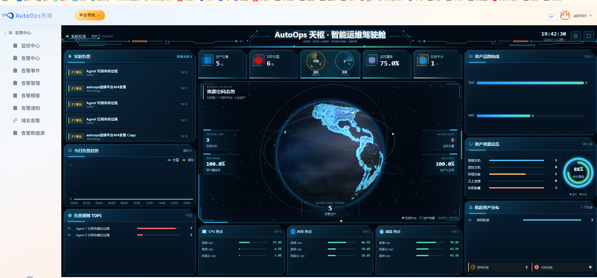
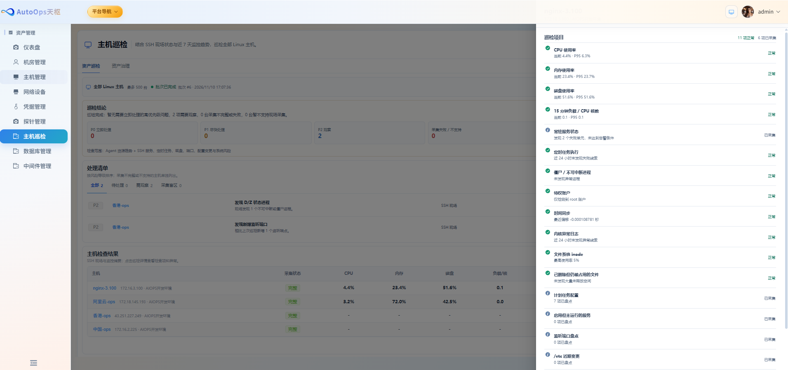
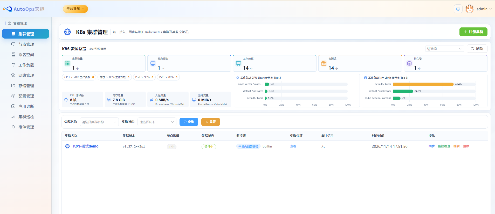
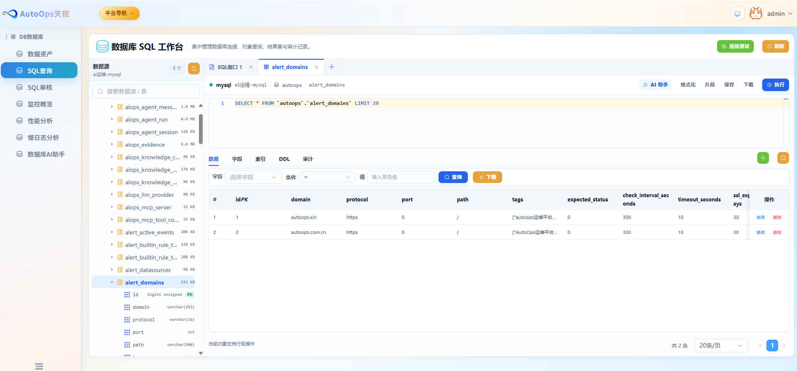
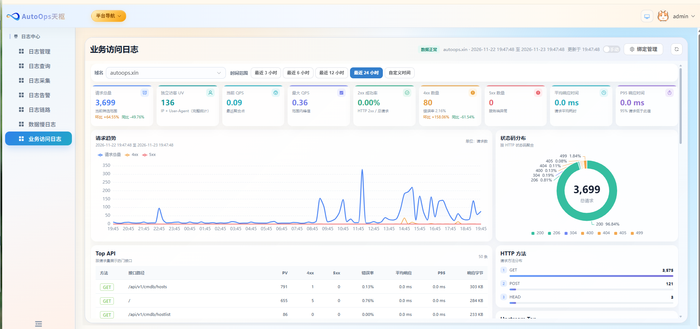
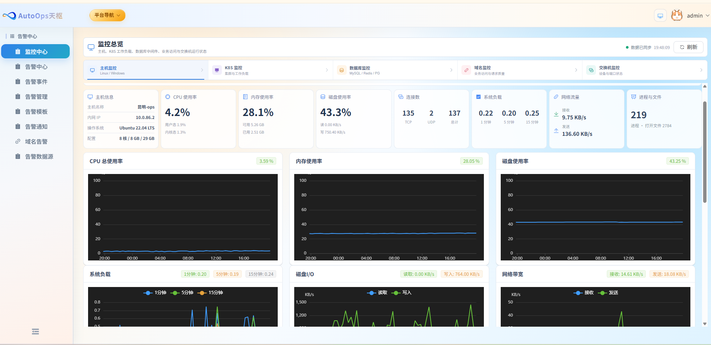
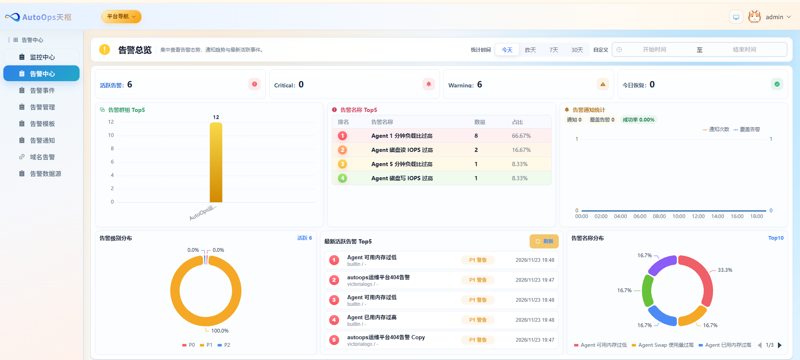
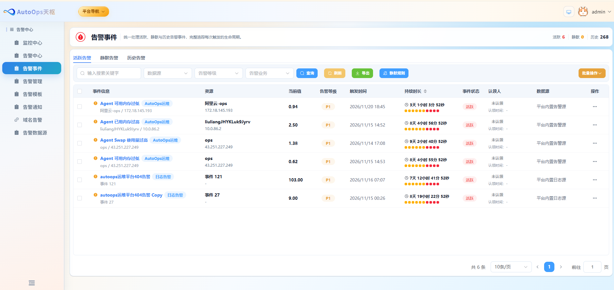
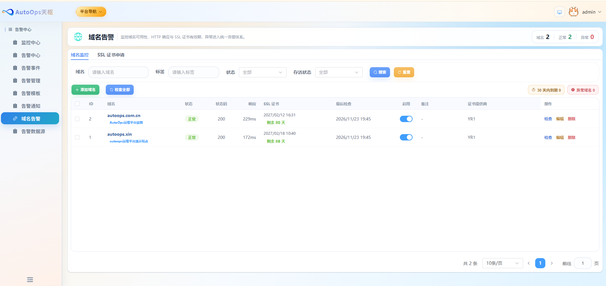

<h1 align="center">天枢 AutoOps v6</h1>
<p align="center"><strong>从资产定位、告警排查到工单处置的一站式运维平台</strong></p>
<p align="center">
  <a href="https://autoops.xin/dashboard">在线演示</a> ·
  <a href="#功能清单">功能清单</a> ·
  <a href="#为什么选-autoops">选型对比</a> ·
  <a href="#v6-更新">v6 更新</a> ·
  <a href="#功能演示">功能演示</a> ·
  <a href="#快速部署">快速部署</a>
</p>

AutoOps 面向同时管理主机、多云资源和 Kubernetes 的运维团队。平台以 **CMDB 资产**为入口，把监控告警、日志、终端、SQL 审核、任务和发布工单放在同一个工作台。收到告警后，可以查找对应资产，查看指标、日志或巡检结果，再按权限进入终端、运行任务或提交变更工单。


## 功能清单

| 模块 | 管理与配置 | 操作与分析 |
| --- | --- | --- |
| **资产管理** | ✅ 机房与机柜　✅ 主机与多云　✅ 网络与中间件 | ✅ 堡垒机与终端　✅ 探针管理　✅ 主机巡检 |
| **容器管理** | ✅ 多集群与节点　✅ 网络与存储　✅ YAML 配置 | ✅ 扩缩容与回滚　✅ Pod 日志与终端　✅ Arthas 诊断 |
| **DB 数据库** | ✅ 数据库资产　✅ SQL 工作台　✅ SQL 审核 | ✅ 审批与回滚　✅ 数据库监控　✅ 慢日志分析 |
| **日志中心** | ✅ 项目与日志库　✅ 解析模板　✅ 日志采集 | ✅ 检索与导出　✅ 日志看板　✅ 日志告警 |
| **配置中心** | ✅ 主机凭据　✅ 通用凭据　✅ 云密钥 | ✅ 连接测试　✅ 云主机同步 |
| **监控告警** | ✅ 指标数据源　✅ 告警规则　✅ 通知与静默 | ✅ 监控大屏　✅ 告警事件　✅ 域名与证书 |
| **费用中心** | ✅ 多云账号　✅ 账单同步 | ✅ 费用概览　✅ 明细导出　✅ 余额告警 |
| **AIOps 运维** | ✅ 模型配置　✅ 知识库　✅ MCP 与 Skill | ✅ 运维助手　✅ 日志分析　✅ 告警分析 |
| **服务作业** | ✅ 脚本模板　✅ 定时任务　✅ Ansible 与 K8s | ✅ 作业启停　✅ 运行日志　✅ 队列与重试 |
| **工单中心** | ✅ 日常工单　✅ 审批流程　✅ 发布应用 | ✅ 工单分派　✅ Jenkins 发布　✅ 构建日志 |
| **审计中心** | ✅ 登录日志　✅ 操作日志　✅ 会话记录 | ✅ 录像回放　✅ 命令审计 |
| **系统管理** | ✅ 用户与角色　✅ 部门与岗位　✅ 菜单权限 | ✅ 系统配置　✅ LDAP　✅ 授权激活 |

## 为什么选 AutoOps

**告警告诉你哪台机器异常，CMDB 帮你查它属于哪个业务、和哪些设备共用依赖，指标和日志帮你验证原因。** AutoOps 把这些信息和终端、工单放在同一平台。排障时可以沿着同一台主机、同一个 Pod 或数据库实例继续查，减少跨系统反复核对 IP、实例名和变更时间。

| 工具与专项强项 | 学习成本 | 时间成本与排障断点 | AutoOps v6 的优势 |
| --- | --- | --- | --- |
| **[夜莺][nightingale]**<br>成熟的告警规则、订阅与通知路由 | **中等** | **知道谁在告警，还要查谁有共同依赖。** 多台主机同时丢包时，设备列表能指出异常主机，机柜位置、业务归属和交换机关系需要另查资产台账。 | ✅ **用资产关系缩小根因范围。** 先按告警查 CMDB 里的主机和设备关系，再对照交换机端口指标、主机趋势和巡检结果，验证是单机故障还是共享链路异常。 |
| **[JumpServer][jumpserver]**<br>细粒度访问授权与会话审计 | **中等** | **知道谁能登录、谁做过操作，还要查机器当时怎么了。** 主机变慢时，授权清单和会话录像之外，还要查 CPU、内存、磁盘和进程趋势。 | ✅ **带着监控证据进终端。** 从资产详情先看资源趋势和巡检结果，缩小排查范围，再按权限登录检查，处置过程可通过会话记录追溯。 |
| **[Jenkins][jenkins]**<br>灵活的流水线与构建执行 | **高** | **构建成功后，仍要验证服务运行。** 上线后错误率升高，需要在发布记录、Pod 状态和应用日志之间核对时间。 | 🔗 **把发布动作和故障时间线对起来。** Jenkins 执行构建，AutoOps 的发布工单保留审批与执行记录，可对照工作负载状态、指标和日志，判断异常是否随发布出现。 |
| **[Kuboard][kuboard]**<br>专注 Kubernetes 资源管理 | **中等** | **Pod 就绪，接口仍可能超时。** 怀疑外部数据库、主机或交换机时，需要切到集群外的运维工具。 | ✅ **顺着应用依赖查到集群外。** 看完 Pod 日志和事件，可在同一平台查看外部数据库指标和网络设备状态，判断排查应留在容器内还是转向外部依赖。 |
| **[独立 CMDB][cmdb]**（以维易 CMDB 为例）<br>灵活的配置项建模与发现 | **高** | **资产拓扑能圈定影响范围，运行异常还要另行验证。** 拿到主机清单后，需要再找监控、巡检和终端。 | ✅ **让资产台账成为排障入口。** 从主机详情查历史指标、发起巡检或连接终端，减少在资产表、看板和堡垒机里重复找机器。 |
| **[Archery][archery]**<br>SQL 审核与 DBA 专项操作 | **中等** | **工单记录能说明改了哪条 SQL，应用变慢还需查运行证据。** DBA 要和应用团队对照慢日志、服务错误和发布时间。 | ✅ **把数据库变更和应用异常放在同一时间线上看。** 对照 SQL 执行记录、数据库趋势、慢日志与应用日志，区分数据库变更和应用发布两个方向。 |
| **[Prometheus][prometheus] + [Grafana][grafana]**<br>指标采集、PromQL 与自定义看板 | **高** | **能指出哪个实例什么时候异常，业务归属和处置入口还需对接。** 日常要维护采集目标、告警规则和看板。 | ✅ **从指标直接查运维资产。** 内置主机、Kubernetes、交换机和数据库看板，可接着查资产、巡检或进入终端。默认使用 VictoriaMetrics，也支持配置 Prometheus 数据源。 |
| **[ELK][elk]**<br>灵活的日志处理、索引与检索 | **高** | **日志能指出哪条请求报错，根因可能在发布或资源侧。** 需按时间和实例另外核对 Pod、主机指标与发布记录。 | ✅ **从错误日志追到运行现场。** 用日志中心找到出错时段，再查对应 Pod、主机指标和发布工单，验证错误是否伴随重启、资源饱和或变更出现。 |
| **AutoOps v6**<br>资产、监控、日志与处置统一入口 | **接近零**<br>日常操作 | ✅ 准备好 Docker 和 Compose 后，一条命令启动整套服务。 | ✅ **装好即有内置工作台。** 接入资产和采集数据后，可按菜单查资产、看指标、搜日志、跑巡检和提工单，减少搭建看板和拼接排障入口的时间。 |

学习成本按首次部署后的常用操作做定性估计。安装命令见 [快速部署](#快速部署)。

## v6 更新

| v6.0 更新 | 运维时能做什么 |
| --- | --- |
| **统一监控大屏** | 集中查看主机、Kubernetes、交换机和数据库等中间件的运行状态 |
| **主机一键巡检与资产治理** | 结合 SSH 现场状态和近 7 天监控趋势，查看巡检结论、待处理项和单台主机检查详情 |
| **网络设备采集与交换机终端** | 使用内置采集器监控多厂商交换机，从网络设备列表打开 SSH 终端 |
| **All-in-One 采集与离线 Agent** | 采集器覆盖主机、MySQL、PostgreSQL 和 Redis。离线环境支持手动上传 Agent 二进制并指定配置文件启动 |
| **日志采集与预览** | 查看业务日志概况、采集详情和异常提醒，从概况进入日志检索 |
| **AI 助手与 Kubernetes 分析** | 优化分析流程和结果展示，调整 Kubernetes 分析判断以减少正常工作负载误报 |

**v6.1 仓库记录**还列出 GPU 监控大屏、GPU 与大模型监控一键配置、内置 Windows Exporter、交换机详情指标，以及模型接口和离线 Agent 部署优化。完整条目见 [v6 更新记录](docs/AutoOps-v6.txt)。

## 功能演示

[打开在线演示](https://autoops.xin/dashboard)，使用演示账号 `test` 和密码 `123456` 登录。下方 15 张截图按实际操作场景排列。

### 统一监控大屏

集中查看资源状态、告警和资产分布，再进入相应模块排查。



### 资产、网络设备与巡检

从仪表盘了解资产全貌，在 CMDB 管理主机、设备和探针，运行主机巡检并查看检查结果。

<details>
<summary>查看资产仪表盘、主机、网络设备、探针与巡检截图（5 张）</summary>

**资产仪表盘**


**主机资产管理**


**网络设备管理**


**探针与主机采集器**


**主机巡检详情**



</details>

### Kubernetes 与数据库

跨集群查看工作负载、YAML 和 Pod 日志。数据库工作台提供查询和导出，SQL 变更可通过审核工单提交。

<details>
<summary>查看 Kubernetes 集群、工作负载与 SQL 工作台截图（3 张）</summary>

**Kubernetes 集群管理**



**Kubernetes 工作负载**


**数据库 SQL 工作台**



</details>

### 日志、指标与告警

从业务日志概况或告警事件进入排查，结合日志检索、主机指标和域名监控缩小问题范围。

<details>
<summary>查看日志查询、业务日志、主机监控、告警与域名监控截图（6 张）</summary>

**日志查询**


**全业务项目日志概况**



**主机监控**



**告警总览**



**告警事件**



**域名监控**



</details>

### 任务、发布与权限

- **任务中心**支持 Shell/Python 脚本、Ansible Playbook、定时调度和运行日志。
- **发布工单**将审批与发布操作关联，可对接 Jenkins 查看构建结果。
- **权限与审计**覆盖 RBAC、LDAP、资产授权、操作日志和终端会话记录。

## 快速部署

准备一台可访问镜像仓库的 Linux 服务器，安装 Docker 和 Docker Compose。下面使用项目部署指南中的 `v6.0` 镜像版本，将 `192.168.1.100` 替换为浏览器和 Agent 都能访问的服务器地址。
```bash
# 提前拉取基础镜像
docker pull crpi-aj3vgoxp9kzh2jx4.cn-hangzhou.personal.cr.aliyuncs.com/zhangfan_k8s/deviops-web:v6.0
docker pull crpi-aj3vgoxp9kzh2jx4.cn-hangzhou.personal.cr.aliyuncs.com/zhangfan_k8s/deviops-api:v6.0
docker pull crpi-aj3vgoxp9kzh2jx4.cn-hangzhou.personal.cr.aliyuncs.com/zhangfan_k8s/mysql:8.0.33
docker pull crpi-aj3vgoxp9kzh2jx4.cn-hangzhou.personal.cr.aliyuncs.com/zhangfan_k8s/redis:6.2
docker pull crpi-aj3vgoxp9kzh2jx4.cn-hangzhou.personal.cr.aliyuncs.com/zhangfan_k8s/victoria-metrics:latest
docker pull crpi-aj3vgoxp9kzh2jx4.cn-hangzhou.personal.cr.aliyuncs.com/zhangfan_k8s/victoria-logs:latest
docker pull crpi-aj3vgoxp9kzh2jx4.cn-hangzhou.personal.cr.aliyuncs.com/zhangfan_k8s/kafka:4.0.0
docker pull crpi-aj3vgoxp9kzh2jx4.cn-hangzhou.personal.cr.aliyuncs.com/zhangfan_k8s/vector:latest-debian
```
### 开始部署
```bash
git clone https://github.com/opsre/AutoOps.git
cd AutoOps/docker
#启动项目
./devops-start.sh v6.0 192.168.1.100 8080
docker compose ps
#停止项目
./devops-stop.sh
```

### 更新版本

```bash
cd AutoOps/docker
./devops-update.sh   v6.1  web api 
```

服务启动后访问 `http://192.168.1.100:8080`。初始管理员账号为 `admin`，密码为 `123456`，首次登录后请修改密码。查看 API 日志可运行 `docker compose logs -f autoops-api`。

默认 Compose 启动 Web、API、MySQL、Redis、VictoriaMetrics、VictoriaLogs、Kafka 和 Vector。[Compose 配置](docker/docker-compose.yml) · [镜像更新说明](docker/update.md) · [安装视频](https://www.bilibili.com/video/BV179Wxz1Ez6/)

## 社区与支持

- 微信技术交流 `zf5391621`
- 邮箱 `zfwh1024@163.com`


<details>
<summary>查看赞助致谢</summary>

感谢为 AutoOps 提供支持的同学。

<p align="center">
  
  
  
  
  
  
  
  
  
  
  
  
</p>

</details>

[nightingale]: https://github.com/ccfos/nightingale
[jenkins]: https://www.jenkins.io/doc/book/pipeline/
[jumpserver]: https://docs.fit2cloud.com/jumpserver/
[kuboard]: https://kuboard.cn/
[cmdb]: https://github.com/veops/cmdb
[archery]: https://github.com/hhyo/Archery
[grafana]: https://grafana.com/docs/grafana/latest/introduction/
[prometheus]: https://prometheus.io/docs/introduction/overview/
[elk]: https://www.elastic.co/what-is/elk-stack
